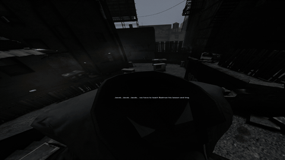
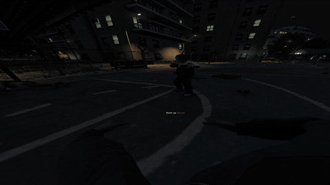
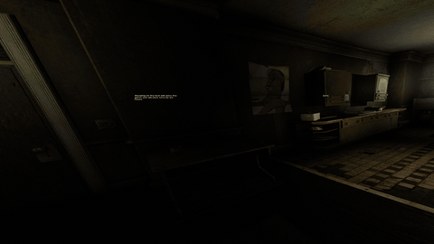
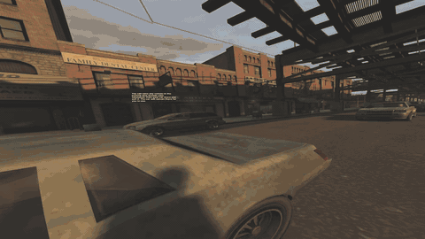
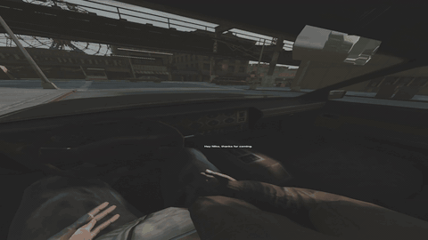

# GTA4VR

> [!IMPORTANT]
> This entire project is fully AI slop coded. While I have a lot of experience with reverse engineering and game modding, I have not reversed or coded anything for this project. It is entirely AI driven and all I've done is instruct it about what I want, which means I have not read basically any of the produced code. I'm sharing the project because I believe there's still some value to it if someone happens to find it interesting.

A single-player VR mod for **Grand Theft Auto IV: The Complete Edition**, built on [FusionFix](https://github.com/ThirteenAG/GTAIV.EFLC.FusionFix).

> **A full VR-only playthrough has not been verified.** Minigames remain unsupported, and some native pickup interactions do not work. Known mission workarounds are listed below. Other story missions may require keyboard/gamepad input or temporarily disabling VR, but no additional mission progression blockers are currently confirmed.

The Lost and Damned and The Ballad of Gay Tony have **not** been tested at all.

## Current features

- **First-person stereo rendering:** independent eye views, headset rotation, room-scale movement with body collision and physical crouching.
- **Tracked hands and arms:** character-rig IK follows the controllers, with button-driven finger poses and physical hand/forearm contact.
- **Locomotion:** head-relative touchpad movement, jogging, sprinting, jumping and strafing/backward movement.
- **Physical firearms:** controller-directed shooting, two-hand aiming, recoil, magazines/shells/rockets, charging handles and slides. The pump shotgun requires pumping after each shot. Sniper scopes render a magnified view inside the scope.
- **Melee and throwing:** tracked punches, knife/bat strikes, and physical grenade/Molotov throws.
- **Physics interaction:** grab, move and throw props; use one or two hands; manipulate car doors, bonnets and trunks; grab ragdolled NPCs. Object weight and arm strength affect movement.
- **Cars:** freely tracked hands, physical steering-wheel grip and rotation, basic driving controls, left-hand drive-by weapon handling and the native phone. Other vehicle classes and combined gameplay routes need more testing.
- **VR UI:** wrist radar with health/armor and wanted stars; a car dashboard radar; stereo subtitles and popup HUD; world-space loading/pause screens with a controller pointer.
- **Physical phone:** the native phone stays in the character's hand, with controller navigation rather than a large HUD replacement.

Physical firearm coverage includes the pistol, combat pistol, Micro-SMG, SMG, AK-47, M4, pump/combat shotguns, both sniper rifles and RPG. Physical reloading is currently an on-foot interaction; vehicles use native ammunition/reload handling.

### Feature showcase

Short clips of the current build; these demonstrate individual features, not a complete playable campaign.

**Firearms and physical reloads**  



**Physical combat**  



**Grabbing and throwing props**  



**Vehicle interactions**  



**Driving and tracked hands**  



## Known limitations and mission blockers

| Limitation | Tracking |
| --- | --- |
| **Minigames:** not currently playable through VR controls. To progress through the required bowling activity in the Michelle mission, enter the bowling minigame and immediately exit it. Playing the activity itself still requires flat-screen controls. | [#14](https://github.com/bordplate/GTA4VR/issues/14) |
| **Bull in a China Shop:** the tutorial's cinder block reacts to physics but cannot be picked up. **Workaround:** smash the shopkeeper's window with your fist instead of picking up and throwing the block. | [#17](https://github.com/bordplate/GTA4VR/issues/17) |

There are also known stereo issues with [traffic-light lamps](https://github.com/bordplate/GTA4VR/issues/1), [objective markers](https://github.com/bordplate/GTA4VR/issues/4) and [water](https://github.com/bordplate/GTA4VR/issues/6). UI coverage, vehicle classes and lifecycle handling remain under development. The desktop currently shows an eye view; an independent third-person desktop camera is [planned](https://github.com/bordplate/GTA4VR/issues/7).

**Performance varies by scene.** Dense city views can easily fall below the headset's refresh rate. A steady 90 FPS experience everywhere is not promised, see [performance work](https://github.com/bordplate/GTA4VR/issues/2).

## Headsets and controllers

**VR testing has only been done with a Vive headset and Vive Wands, using SteamVR on Windows.** The recorded development setup is a VIVE Pro at 90 Hz, GTA IV Complete Edition 1.2.0.59 and the DXVK/Vulkan rendering path.

| Configuration | What to expect |
| --- | --- |
| Tested Vive + Wands + SteamVR setup | The reference configuration for the features described above; known limitations still apply. |
| Other headsets through SteamVR | Headset rendering and tracking are plausible because the mod uses OpenXR. This is an engineering expectation, **not tested compatibility**. |
| Index, Touch or other controllers | Untested. The code currently supplies default bindings only for the Vive controller profile. Expect custom SteamVR bindings and possibly code changes or hand/weapon pose calibration; plug-and-play support is not promised. |
| Other OpenXR runtimes, standalone headsets without PC streaming, or Linux/Proton | Untested. The current Vulkan bootstrap is SteamVR-specific; OpenXR support alone does not establish compatibility. |

There is not enough testing to give a meaningful percentage chance that another configuration will work. Other SteamVR headsets are a more plausible first experiment than changing both the runtime and controllers. Headset compatibility and usable controller bindings are separate questions. See the [OpenXR interaction-profile specification](https://registry.khronos.org/OpenXR/specs/1.1/html/xrspec.html#semantic-paths-interaction-profiles) for the underlying input model.

## Installation

1. Install the official Windows **GTA IV: The Complete Edition** and [SteamVR](https://store.steampowered.com/app/250820/SteamVR/). In SteamVR settings, make SteamVR the active OpenXR runtime.
2. Download **GTA4VR.zip** from [Releases](https://github.com/bordplate/GTA4VR/releases/latest).
3. Extract its contents directly into the game folder containing **GTAIV.exe**. For Steam, this is normally `steamapps/common/Grand Theft Auto IV/GTAIV`. Allow the mod files to merge/replace after backing up any existing mod installation.
4. Start SteamVR, turn on your headset/controllers, then launch the game normally.

**You do not need a separate FusionFix.** The package includes the FusionFix base, ASI loader, DXVK, OpenXR loader, and VR configuration.

Optional web/offline installers are also provided in releases.

### Configuration and flat-screen play

Settings are in `plugins/GTAIV.EFLC.FusionFix.ini`, with weapon profiles in `plugins/VRWeapons/`. Configure `[VR] PlayerHeight` for your height in metres; in-game calibration is planned. Controller actions can be rebound through SteamVR.

To play a blocked section on a flat screen, quit, set **`[VR] DisableOpenXR=1`** in the INI and relaunch. After completing the section, quit, set **`DisableOpenXR=0`** and relaunch. The old `EnableOpenXR` option is no longer used. Keep a keyboard/gamepad available. Missing or unsupported runtime/headset initialization should fall back to flat-screen play.

Development diagnostics remain off by default. Advanced graphics options and the optional SteamVR path override are covered in [graphics bridge notes](docs/vulkan-openxr-feasibility.md) and [diagnostic settings](docs/vr-diagnostics.md).

## Vive Wand controls

Bindings are named actions in SteamVR and can be customized. These are the current default gestures; an existing custom binding may need newly added actions assigned manually.

| Context | Controls |
| --- | --- |
| Move | Touch the left trackpad; its outer edge jogs. Hold its click to sprint. |
| Jump / weapon selection | Right trackpad center click jumps; left/right clicks cycle weapons. |
| Pause / phone | Tap left Menu for pause or to skip a cutscene; hold it to open the phone, including while driving. |
| Fire / support | Right trigger fires on foot. Hold left grip near the weapon to support it. |
| Grab | Grip near an object with a free hand; hold to retain it. |
| Reload | Right grip ejects supported magazines; left grip over the shoulder retrieves ammunition. Insert it, then manipulate the slide/handle/pump as required by the weapon. Ejected magazine ammunition is discarded. |
| Vehicle entry/exit | Right Menu. |
| Driving | Right trigger accelerates; left trigger brakes/reverses. Touch left trackpad to steer, or grip the wheel. Right trackpad center click is handbrake; upper click is horn. |
| Armed driving | Left trigger fires the left-hand weapon; left trackpad click brakes/reverses. Right trackpad side clicks select weapons, including unarmed. |
| Phone | Right trackpad directional clicks navigate; center confirms. Right Menu goes back. |
| Pause menus | Point with the right controller and press the trigger; right Menu goes back. |

See [controller actions](docs/vr-controller-actions.md), [vehicle interactions](docs/vehicle-interactions.md) and the weapon-specific documents under [`docs`](docs). Some technical notes describe earlier development stages; their historical three-digit issue IDs are not current GitHub issue numbers.

## Building

Clone with submodules and use Visual Studio 2026 with the C++ toolchain and Windows SDK:

```powershell
git clone --recurse-submodules https://github.com/bordplate/GTA4VR.git
cd GTA4VR
.\premake5.bat
msbuild build/GTAIV.EFLC.FusionFix.slnx /m /p:Configuration=Release /p:Platform=Win32
```

The plugin is built under `bin`. The OpenXR loader is built separately; consult the [build workflow](.github/workflows/msvc_x86.yml) for dependency and packaging steps. The release packaging step includes the credited Animated Weapons models and generated FusionFix data.

Optional automatic ASI deployment uses an ignored `.env` file with `GTAIV_DIR` pointing to the directory containing `GTAIV.exe`. It replaces an already installed plugin, so back it up first. Without `.env`, the build does not deploy to the game.

## Development and reporting issues

Use the [GitHub issue tracker](https://github.com/bordplate/GTA4VR/issues) for bugs and missing interactions. Include the game version/episode, headset, controllers, OpenXR runtime, graphics backend and reproduction steps. State whether the problem also occurs with VR disabled.

See [ROADMAP.md](ROADMAP.md) for scope and remaining work. Short showcase clips demonstrate individual features; they should not be taken as evidence of a complete playable campaign.

## Credits and license

- [FusionFix and its contributors](https://github.com/ThirteenAG/GTAIV.EFLC.FusionFix) provide the foundation. Original documentation and acknowledgements are preserved in [readme.fusionfix.md](readme.fusionfix.md).
- [DXVK](https://github.com/doitsujin/dxvk) provides the D3D9-to-Vulkan backend; [OpenXR](https://github.com/KhronosGroup/OpenXR-SDK) provides the headset/runtime interface.
- [Animated Weapons](https://www.nexusmods.com/gta4/mods/641) supplies the bundled weapon models/animations. See [dependency attribution](third_party/animated-weapons/NOTICE.md) for the authors and tested asset layout.

Project code retains the **GPL-3.0** license; see [license](license). Third-party dependencies and the credited weapon assets retain their own notices and terms. The GTA IV game itself is not included.
